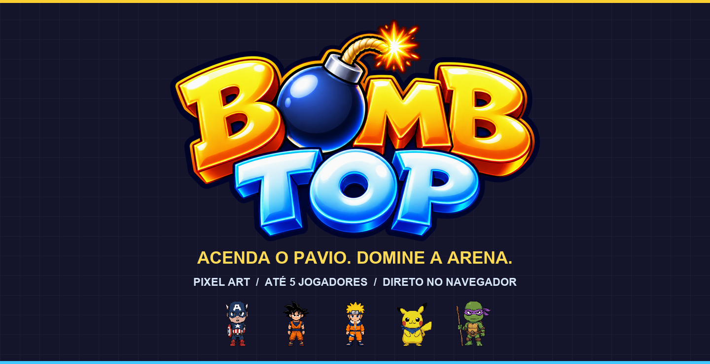
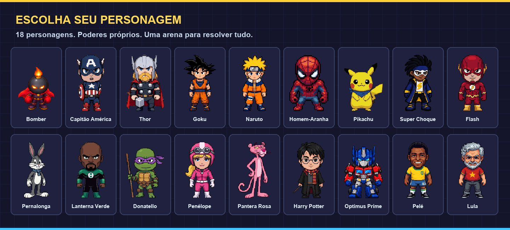

<div align="center">



# Bombtop

**O caos das batalhas de bombas de 16 bits, com um elenco improvável e uma arena no seu navegador.**

Destrua blocos. Colete poderes. Prepare a reação em cadeia. Tente sair vivo.


[Começar](#-entre-na-arena) · [Personagens](#-escolha-seu-personagem) · [Controles](#-controles) · [Instalação](#-rode-no-seu-computador) · [Referências](#-documentação-e-referências)

</div>

---

## 💣 Entre na arena

Bombtop é um jogo de batalha multiplayer inspirado no modo competitivo de **Super Bomberman 4**. Até **5 participantes, somando pessoas e bots**, disputam arenas de blocos destrutíveis, explosões em cadeia e habilidades especiais. O foco é batalha: não há campanha de história.

| Escolha seu jeito de jogar | Como funciona |
| :--- | :--- |
| 🌐 **Online** | Entre em uma partida pública ou crie uma sala para amigos, com convite por código e link. |
| 📶 **Wi-Fi / rede local** | Um dispositivo hospeda a partida no navegador e os demais se conectam por WebRTC. |
| 🎮 **Na mesma tela** | Conecte vários controles a um computador e reúna a turma no sofá. |
| 🤖 **Com bots** | Complete a sala com oponentes de dificuldade fácil, média ou difícil. |
| 📺 **Modo TV** | Acompanhe uma sala como espectador, sem ocupar uma das cinco vagas de jogador. |

**Primeira partida:** abra o jogo, escolha um personagem, crie ou entre em uma sala e aguarde o anfitrião iniciar. Está sozinho? Adicione bots. A partida precisa de pelo menos dois participantes.

## ⚡ Escolha seu personagem



Um crossover em pixel art com **18 personagens** e especiais próprios: escudos, raios, energia, teias e outras formas de virar a rodada. O guia **Personagens**, disponível no menu e na rota `/personagens`, reúne habilidades, dicas e demonstrações animadas.

As imagens deste README são composições do logo e dos sprites reais do projeto; não são capturas de uma partida. A galeria mostra a arte base, que pode receber as cores do jogador durante o jogo.

## 🔥 Cada bomba muda o mapa

- **Reações em cadeia:** uma explosão pode disparar outras bombas e transformar um corredor seguro em armadilha.
- **Power-ups:** aumente sua capacidade de bombas, alcance e velocidade; encontre chute, soco, luva e bombas especiais.
- **Habilidades de personagem:** use seu especial no momento certo e administre a recarga.
- **Arenas com personalidade:** cenários com esteiras, portais e mecânicas inspiradas nos mapas de batalha de SB4.
- **Regras de sala:** configure rodadas, tempo, rotação de arenas e opções de batalha no lobby.
- **Single, Tag e Maniac:** disputa individual, equipes ou configuração alternativa de batalha.

O guia **Itens**, na rota `/itens`, explica os recursos disponíveis. Ação, defesa e parada de bomba têm funções diferentes: conhecer os controles faz parte da estratégia.

> A fidelidade às regras e aos mapas de SB4 está em evolução. Os relatórios de paridade e investigações abaixo registram o que foi analisado, implementado e o que ainda precisa de validação.

## 🎮 Controles

| Comando | Teclado WASD | Teclado com setas | Controle padrão |
| :--- | :---: | :---: | :---: |
| Mover | `W A S D` | `↑ ← ↓ →` | Direcional / analógico esquerdo |
| Colocar bomba | `Espaço` | `Enter` | `A` / ✕ |
| Ação | `Shift esquerdo` | `Shift direito` | `B` ou `X` / ○ ou □ |
| Especial | `E` | `Ctrl direito` | `Y` / △ |
| Defesa | `Q` | `Num 0` | `LB` / `L1` |
| Parar bomba chutada | `R` | `Num 1` | `RB` / `R1` |
| Voltar ao menu | `Esc` | `Esc` | Menu da partida |

**Ação** depende do equipamento e da situação, como detonar uma bomba remota ou socar uma bomba. Os dois layouts de teclado são alternativas para **o mesmo jogador**, não dois jogadores independentes.

**No celular:** use o direcional fixo ou o joystick flutuante e os botões de toque. O menu da partida permite trocar o estilo de movimento.

**Vários controles:** no lobby local, `A` entra, `Y` troca de personagem, `B` sai e `Start` inicia a partida. O teclado e o primeiro controle comandam o mesmo jogador; controles adicionais recebem suas próprias vagas.

## 📱 Do celular à TV

O cliente é uma **PWA**: em um navegador compatível, você pode instalá-lo pela opção de instalação ou adicionar à tela inicial. O modo leve ajuda em telas com menos recursos e pode ser ativado com `?lite`.

<details>
<summary><strong>Como funciona jogar sem internet?</strong></summary>

Abra o jogo com internet antes, para que o service worker conclua o cache dos recursos. Depois, a opção **Jogar offline** permite que um dispositivo hospede a sala no navegador.

Os amigos se conectam por WebRTC. A descoberta automática de salas depende do servidor e de internet; sem internet, o pareamento pode ser feito pela troca de dois QR codes ou pela cópia dos códigos de conexão. Os dispositivos precisam conseguir se comunicar na rede: isolamento entre clientes do Wi-Fi pode impedir a conexão.

O anfitrião mantém a simulação da sala. Se ele sair, a sala termina. Câmera, instalação e service worker dependem das permissões e do suporte do navegador; fora de `localhost`, use HTTPS.

</details>

## 🛠 Rode no seu computador

Use **Node.js 24** e **pnpm 12.11.2**, versões adotadas na configuração de deploy do repositório. Você também precisa de Git.

```bash
git clone https://github.com/gleisonkz/bombtop.git
cd bombtop
pnpm install --frozen-lockfile
pnpm dev
```

Abra [localhost:5173](http://localhost:5173). O servidor de jogo usa WebSocket na porta `2567`. O comando inicia cliente e servidor em paralelo.

### Configuração opcional

Sem Supabase, o jogo funciona como convidado. Para personalizar servidor ou habilitar autenticação, copie os exemplos para arquivos `.env` nos respectivos diretórios:

```powershell
# PowerShell — execute na raiz do projeto
Copy-Item apps/client/.env.example apps/client/.env
Copy-Item apps/server/.env.example apps/server/.env
```

Em macOS/Linux, use `cp` nos mesmos caminhos. Se já houver um `.env`, edite-o em vez de sobrescrevê-lo.

| Arquivo | Variável | Uso |
| :--- | :--- | :--- |
| `apps/client/.env` | `VITE_SERVER_URL` | Endereço público do servidor; vazio usa o host da página e porta `2567`. |
| `apps/client/.env` | `VITE_SUPABASE_URL` / `VITE_SUPABASE_ANON_KEY` | Configuração pública do login pelo Supabase. |
| `apps/server/.env` | `PORT` | Porta do servidor; padrão `2567`. |
| `apps/server/.env` | `SUPABASE_URL` / `SUPABASE_ANON_KEY` | Configuração do Supabase no servidor. |
| `apps/server/.env` | `REQUIRE_AUTH` | `false` permite convidados; `true` exige autenticação. |

O login Google também precisa estar configurado no projeto Supabase. Nunca use uma chave `service_role` no cliente nem versione arquivos `.env`.

### Comandos úteis

| Comando | Finalidade |
| :--- | :--- |
| `pnpm dev` | Cliente e servidor em desenvolvimento. |
| `pnpm dev:client` | Apenas o cliente Vite. |
| `pnpm dev:server` | Apenas o servidor de jogo. |
| `pnpm test` | Testes dos pacotes do monorepo. |
| `pnpm typecheck` | Verificação de tipos de todos os pacotes. |
| `pnpm -C apps/client build` | Build de produção do cliente em `apps/client/dist`. |
| `pnpm -C apps/client preview` | Prévia local do cliente compilado; o servidor de jogo roda separadamente. |
| `pnpm -C packages/shared bench` | Benchmark dos ticks da simulação e dos bots. |

## 🧩 Por dentro da arena

```text
bombtop/
├── apps/
│   ├── client/       # PixiJS, interface, controles, áudio e PWA
│   └── server/       # Colyseus: salas online e transporte WebSocket
├── packages/
│   └── shared/       # Simulação, regras, bots e núcleo das salas
├── docs/             # Investigações, paridade e apresentação
├── concept/          # Referências e estudos de arte
└── deploy/vps/       # Configuração e operação do servidor
```

**Uma simulação compartilhada, diferentes formas de conectar.** O pacote `shared` concentra as regras e o núcleo de sala, sem depender da interface. Online, o servidor executa a simulação autoritativa e recebe comandos dos jogadores. No modo local, o navegador anfitrião executa esse núcleo e conecta os demais dispositivos por WebRTC.

| Camada | Tecnologia | Papel no projeto |
| :--- | :--- | :--- |
| Linguagem | TypeScript | Código do cliente, servidor e simulação. |
| Renderização | PixiJS 8 | Sprites, arena, animações e efeitos 2D. |
| Cliente | Vite 8 | Desenvolvimento e build da aplicação web. |
| Multiplayer online | Colyseus 0.18 | Conexões, salas e integração com o núcleo compartilhado. |
| Instalação e cache | vite-plugin-pwa | Manifesto e service worker. |
| Autenticação opcional | Supabase | Login Google. |
| Testes | Vitest | Testes automatizados dos pacotes. |

Para publicar, consulte o [Blueprint do Render](render.yaml) e o [guia do servidor VPS](deploy/vps/README.md). Rotas como `/sala/<código>`, `/wifi/<código>`, `/tv/<código>`, `/itens` e `/personagens` precisam retornar o cliente SPA. Configure `VITE_SERVER_URL` no build para apontar ao servidor público.

## 📚 Documentação e referências

### O projeto como fonte de verdade

| Documento | O que você encontra |
| :--- | :--- |
| [Arquitetura e decisões](CLAUDE.md) | Organização do código, rede, controles e decisões técnicas. |
| [Paridade com Super Bomberman 4](BOMBERMAN4-PARIDADE.md) | Acompanhamento das regras e mecânicas de referência. |
| [Auditoria de itens e mapas](BOMBERMAN4-AUDITORIA-ITENS-MAPAS.md) | Comparações e pontos de investigação. |
| [Comparação de itens](docs/SB4-COMPARACAO-ITENS.md) | Estudo do comportamento dos itens. |
| [Mecânicas pendentes](docs/SB4-MECANICAS-PENDENTES-ROM.md) | Lacunas e questões ainda abertas. |
| [Investigação técnica SB4](docs/SB4-REA-INVESTIGACAO.md) | Evidências e análise do comportamento de referência. |
| [Carrinhos](docs/SB4-CARRINHO-ROM.md) · [Mapa 08](docs/SB4-MAPA08-ROM.md) · [Mapa 09](docs/SB4-MAPA09-ROM.md) | Estudos específicos de arenas e transporte. |
| [Arte das arenas SB4](concept/tiles/sb4-battle/README.md) | Materiais e referências visuais dos cenários. |

### Referências técnicas oficiais

- [PixiJS 8 — introdução e conceitos](https://pixijs.com/8.x/guides/getting-started/intro): referência para a camada de renderização 2D.
- [Colyseus 0.18 — documentação](https://docs.colyseus.io/): referência para salas e integração multiplayer.
- [Vite — documentação](https://vite.dev/guide/): ferramentas de desenvolvimento e build.
- [Vite PWA — guia](https://vite-pwa-org.netlify.app/guide/): conceitos de manifesto, instalação e cache; confira a versão instalada antes de aplicar exemplos.
- [Supabase Auth](https://supabase.com/docs/guides/auth): configuração do provedor de autenticação opcional.
- [WebRTC — MDN](https://developer.mozilla.org/en-US/docs/Web/API/WebRTC_API): fundamentos das conexões entre dispositivos.

As versões declaradas estão nos arquivos [do cliente](apps/client/package.json), [do servidor](apps/server/package.json) e no [lockfile](pnpm-lock.yaml). Os relatórios de SB4 são investigações deste projeto, não documentação oficial da franquia.

## 🤝 Contribua com a próxima rodada

Encontrou um problema? [Abra uma issue](https://github.com/gleisonkz/bombtop/issues) com passos para reproduzir, dispositivo, navegador e modo de jogo. Vídeos curtos ajudam quando o defeito depende de movimento ou sincronização.

Para mudanças no código, preserve a separação entre simulação, transporte e apresentação. Execute `pnpm test`, `pnpm typecheck` e o build do cliente; alterações de simulação ou bots também devem considerar o benchmark. Ao mudar uma regra, atualize a documentação correspondente.

## 🎨 Arte, créditos e uso

Bombtop é um **fan project não comercial**, inspirado nas batalhas clássicas de Super Bomberman. O elenco inclui fan art e referências a personagens, marcas e personalidades preexistentes; o projeto não afirma autoria sobre essas propriedades nem afiliação ou endosso de seus titulares.

Os créditos por asset estão em [Sprite licenses](apps/client/public/sprites/LICENSES.md). O logo usado na capa está em [`apps/client/public/branding`](apps/client/public/branding) e os sprites em [`apps/client/public/sprites`](apps/client/public/sprites). As composições deste README podem ser refeitas com `python docs/readme/build-art.py` e [Pillow](https://pillow.readthedocs.io/), sem alterar os assets do jogo.

Não há licença de distribuição definida em um arquivo `LICENSE` na raiz. Código, imagens, nomes e áudio não devem ser presumidos livres para redistribuição; consulte a autoria e as permissões aplicáveis antes de reutilizá-los.

---

<div align="center">

**Uma bomba. Um corredor. Uma péssima ideia.**

[Voltar ao topo](#bombtop)

</div>
